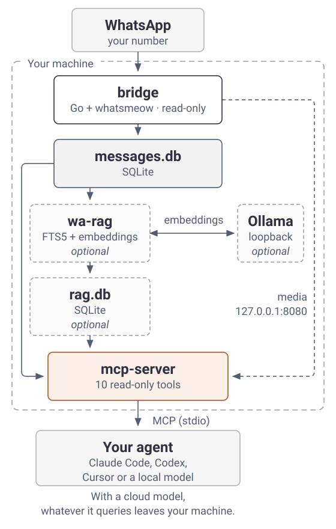

# whatsapp-agent-kit

[Español](README.md) · **English**

A kit that gives your agent read-only access to your WhatsApp. Ingestion, indexing and search all run on your machine.

> **ToS notice:** this uses unofficial WhatsApp clients (whatsmeow, Baileys), outside Meta's terms of service. The account can be suspended. The bridge only reads; the group bot does send, so use it with a disposable number.

<picture>
  <source media="(prefers-color-scheme: dark)" srcset="docs/assets/arquitectura.en.dark.svg">
  
</picture>

No arrow goes back to WhatsApp: nothing on this path has code that sends messages.

## What you can do

Questions your agent can answer:

- "What's still pending today in the project group?": `list_messages`, `get_chat`
- "When was the last time I talked to María?": `get_last_interaction`
- "Where did we talk about the client's quote?": `search_messages_semantic` (needs wa-rag)
- "Download the PDF they sent me": `download_media`

## How it works

1. The bridge receives messages and stores them in SQLite: [`bridge/main.go`](bridge/main.go) (`handleMessage`, `StoreMessage`).
2. The MCP server exposes 10 read-only tools over stdio: [`mcp-server/main.py`](mcp-server/main.py) (`@mcp.tool()`).
3. If you want to search by meaning, wa-rag builds a separate index (`rag.db`) with FTS5 and Ollama embeddings on loopback, and the MCP queries it: [`wa-rag/rag.py`](wa-rag/rag.py) (`sync_index`, `search`).
4. Nothing can send. The send code was removed from the bridge and the MCP, and a CI test fails if a send tool appears: [`docs/NEVER_SEND.md`](docs/NEVER_SEND.md), [`mcp-server/test_never_send.py`](mcp-server/test_never_send.py). The bridge API only listens on 127.0.0.1 (`restAddr` in [`bridge/main.go`](bridge/main.go)).

## Minimum: bridge + MCP

You need Go 1.25+ with a C compiler (`xcode-select --install` on macOS, `build-essential` on Debian/Ubuntu), Python 3.11+ and [uv](https://docs.astral.sh/uv/).

```sh
cd bridge
CGO_ENABLED=1 go build -o whatsapp-bridge .
./whatsapp-bridge
```

The first run prints a QR code in the terminal. Scan it from WhatsApp under Linked devices > Link a device and leave the bridge running.

In another terminal:

```sh
cd mcp-server
uv run python test_never_send.py   # checks that no send tool is registered
claude mcp add whatsapp -- uv --directory "$PWD" run main.py
```

For other stdio MCP clients: command = `uv run main.py`, cwd = `mcp-server/`.

To try it, ask your agent which chats had activity today.

> **Privacy:** the agent sees your whole history. A local model is recommended; with a cloud model, anything it reads goes to that provider. For third-party agents there is the scoped profile `wa-rag/wa-work-mcp.sh`.

## Optional extras

| Extra | What for | Needs | Guide |
| --- | --- | --- | --- |
| Semantic search | Ask by meaning, not exact words | Ollama + `nomic-embed-text` | [wa-rag/README.md](wa-rag/README.md#correr) |
| Media to text | Search inside images, audio and PDFs | `qwen3-vl:8b`, faster-whisper, poppler | [wa-rag/README.md](wa-rag/README.md#media-imagen-audio-documento) |
| Work profile | An MCP scoped to work groups for third-party agents | wa-rag | [wa-rag/README.md](wa-rag/README.md#dos-perfiles) |
| Group bot template | A disposable number that posts to groups | Node 22.9+ | [grupo-bot/README.md](grupo-bot/README.md) |
| 24/7 on Linux | systemd --user services | systemd with lingering | [deploy/README.md](deploy/README.md) |

The per-component guides are in Spanish. Full requirements per piece: [REQUIREMENTS.md](REQUIREMENTS.md).

## Layout

| Folder | What's inside |
| --- | --- |
| `bridge/` | Go bridge (whatsmeow): pairs your number and dumps chats and messages to `store/messages.db`. HTTP API on 127.0.0.1:8080 for media downloads. |
| `mcp-server/` | Python MCP server (FastMCP): 10 read-only tools over the history. |
| `wa-rag/` | FTS5 + embeddings index in `rag.db`, image captions, audio transcripts and document text. Scoped profile for third-party agents. |
| `grupo-bot/` | Baileys group-bot template for a disposable number. |
| `deploy/` | systemd --user units and the Linux server layout. |
| `docs/` | NEVER_SEND, the media-index ADR and deploy learnings. |

## Tests

```sh
(cd bridge && go test ./...)
(cd wa-rag && python3 test_rag.py && python3 test_media_index.py && python3 test_archive_import.py)
(cd mcp-server && uv run python test_never_send.py)
```

CI runs the same thing on every PR: [.github/workflows/check.yml](.github/workflows/check.yml).

## Credits

- `bridge/` and `mcp-server/` start from [lharries/whatsapp-mcp](https://github.com/lharries/whatsapp-mcp) (MIT), with everything that sends removed.
- [whatsmeow](https://github.com/tulir/whatsmeow) for the bridge, [Baileys](https://github.com/WhiskeySockets/Baileys) for the bot.
- The diagram and the [How it works](#how-it-works) walkthrough were made with [legibify](https://github.com/G10hdz/legibify).

## License

[MIT](LICENSE).
