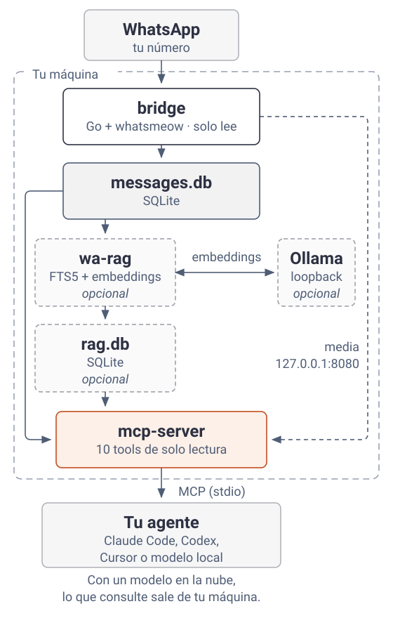

# whatsapp-agent-kit

**Español** · [English](README.en.md)

Un kit que le da a tu agente acceso de solo lectura a tu WhatsApp. La ingesta, el índice y la búsqueda corren en tu máquina.

> **Aviso de ToS:** usa clientes no oficiales de WhatsApp (whatsmeow, Baileys), fuera de los términos de servicio de Meta. La cuenta puede ser suspendida. El bridge solo lee; el bot de grupo sí envía, así que úsalo con un número desechable.

<picture>
  <source media="(prefers-color-scheme: dark)" srcset="docs/assets/arquitectura.es.dark.svg">
  
</picture>

Ninguna flecha regresa a WhatsApp: en este camino no hay código que envíe mensajes.

## Qué puedes hacer

Preguntas que tu agente puede responder:

- "¿Qué quedó pendiente hoy en el grupo del proyecto?": `list_messages`, `get_chat`
- "¿Cuándo fue la última vez que hablé con María?": `get_last_interaction`
- "¿Dónde hablamos de la cotización del cliente?": `search_messages_semantic` (necesita wa-rag)
- "Descarga el PDF que me mandaron": `download_media`

## Cómo funciona

1. El bridge recibe mensajes y los guarda en SQLite: [`bridge/main.go`](bridge/main.go) (`handleMessage`, `StoreMessage`).
2. El servidor MCP expone 10 tools de solo lectura por stdio: [`mcp-server/main.py`](mcp-server/main.py) (`@mcp.tool()`).
3. Si quieres buscar por significado, wa-rag arma un índice aparte (`rag.db`) con FTS5 y embeddings de Ollama en loopback, y el MCP lo consulta: [`wa-rag/rag.py`](wa-rag/rag.py) (`sync_index`, `search`).
4. Nada puede enviar. El código de envío se eliminó del bridge y del MCP, y un test en CI falla si aparece una tool de envío: [`docs/NEVER_SEND.md`](docs/NEVER_SEND.md), [`mcp-server/test_never_send.py`](mcp-server/test_never_send.py). La API del bridge solo escucha en 127.0.0.1 (`restAddr` en [`bridge/main.go`](bridge/main.go)).

## Lo mínimo: bridge + MCP

Necesitas Go 1.25+ con un compilador C (`xcode-select --install` en macOS, `build-essential` en Debian/Ubuntu), Python 3.11+ y [uv](https://docs.astral.sh/uv/).

```sh
cd bridge
CGO_ENABLED=1 go build -o whatsapp-bridge .
./whatsapp-bridge
```

La primera vez imprime un QR en la terminal. Escanéalo desde WhatsApp en Dispositivos vinculados > Vincular un dispositivo y deja el bridge corriendo.

En otra terminal:

```sh
cd mcp-server
uv run python test_never_send.py   # comprueba que no hay tools de envío
claude mcp add whatsapp -- uv --directory "$PWD" run main.py
```

Para otros clientes MCP por stdio: command = `uv run main.py`, cwd = `mcp-server/`.

Para probar, pregúntale a tu agente qué chats tuvieron actividad hoy.

> **Privacidad:** el agente ve todo tu historial. Se recomienda un modelo local; con un modelo en la nube, lo que consulte sale hacia ese proveedor. Para agentes de terceros existe el perfil acotado `wa-rag/wa-work-mcp.sh`.

## Extras opcionales

| Extra | Para qué | Necesita | Guía |
| --- | --- | --- | --- |
| Búsqueda semántica | Preguntar por significado, no por palabra exacta | Ollama + `nomic-embed-text` | [wa-rag/README.md](wa-rag/README.md#correr) |
| Media a texto | Buscar dentro de imágenes, audios y PDFs | `qwen3-vl:8b`, faster-whisper, poppler | [wa-rag/README.md](wa-rag/README.md#media-imagen-audio-documento) |
| Perfil de trabajo | Un MCP acotado a grupos para agentes de terceros | wa-rag | [wa-rag/README.md](wa-rag/README.md#dos-perfiles) |
| Plantilla de bot de grupo | Un número desechable que publica en grupos | Node 22.9+ | [grupo-bot/README.md](grupo-bot/README.md) |
| 24/7 en Linux | Servicios systemd --user | systemd con lingering | [deploy/README.md](deploy/README.md) |

Requisitos completos por pieza: [REQUIREMENTS.md](REQUIREMENTS.md).

## Estructura

| Carpeta | Qué hay dentro |
| --- | --- |
| `bridge/` | Bridge en Go (whatsmeow): vincula tu número y vuelca chats y mensajes a `store/messages.db`. API HTTP en 127.0.0.1:8080 para descargar media. |
| `mcp-server/` | Servidor MCP en Python (FastMCP): 10 tools de solo lectura sobre el historial. |
| `wa-rag/` | Índice FTS5 + embeddings en `rag.db`, captions de imagen, transcripts de audio y texto de documentos. Perfil acotado para agentes de terceros. |
| `grupo-bot/` | Plantilla de bot de grupo con Baileys para un número desechable. |
| `deploy/` | Units systemd --user y layout del servidor Linux. |
| `docs/` | NEVER_SEND, ADR del índice de media y lecciones del deploy. |

## Tests

```sh
(cd bridge && go test ./...)
(cd wa-rag && python3 test_rag.py && python3 test_media_index.py && python3 test_archive_import.py)
(cd mcp-server && uv run python test_never_send.py)
```

CI corre lo mismo en cada PR: [.github/workflows/check.yml](.github/workflows/check.yml).

## Créditos

- `bridge/` y `mcp-server/` parten de [lharries/whatsapp-mcp](https://github.com/lharries/whatsapp-mcp) (MIT), con todo lo que envía eliminado.
- [whatsmeow](https://github.com/tulir/whatsmeow) para el bridge, [Baileys](https://github.com/WhiskeySockets/Baileys) para el bot.
- El diagrama y el recorrido de [Cómo funciona](#cómo-funciona) se hicieron con [legibify](https://github.com/G10hdz/legibify).

## Licencia

[MIT](LICENSE).
